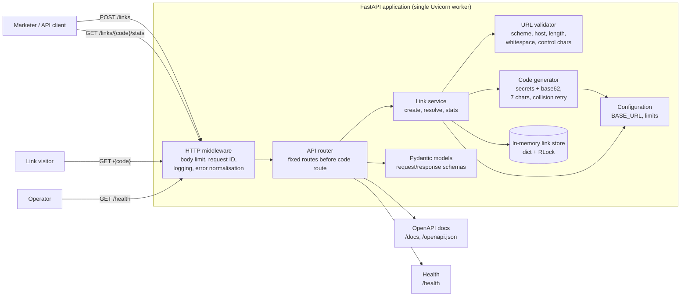

# Design — US-102 (AIH-102) URL Shortener API

## Final Technology Stack

- **Language:** Python 3.12
- **Web framework:** FastAPI
- **Data models:** Pydantic
- **ASGI server:** Uvicorn, one worker process
- **Storage:** In-process memory (`dict` guarded by `threading.RLock`)
- **Tests:** pytest with httpx/TestClient
- **UI:** None; the release is a JSON API only
- **Runtime dependencies:** FastAPI, Uvicorn, Pydantic; no database, cache, or external service

## Architecture Overview

The service is a single-process FastAPI application. An HTTP request passes through request-validation and observability middleware, is dispatched by fixed routes before the short-code route, and is served by a link service backed by an in-memory store. The store owns all link state for the lifetime of the process.

### Components

| Component | Responsibility |
|---|---|
| Client actors | Marketers create links and read statistics; visitors resolve links; operators call the health endpoint. |
| HTTP middleware | Enforces the 64 KiB body limit, validates JSON content type where required, assigns a request ID, records method/path/status/timing, and normalises errors where practical. |
| API router | Exposes `POST /links`, `GET /links/{code}/stats`, `GET /{code}`, `GET /health`, `/docs`, and `/openapi.json`. Fixed routes are registered before the code route. |
| URL validator | Accepts only absolute `http`/`https` URLs with a non-empty host and no whitespace or ASCII control characters; enforces the 2,048-character limit. |
| Code generator | Produces cryptographically secure, case-sensitive 7-character base62 codes and regenerates on collision. Reserved path segments are never issued. |
| Link service | Coordinates validation, creation, lookup, click increments, statistics, UTC timestamps, and short-URL construction. |
| In-memory link store | Holds `code -> LinkRecord` in a dictionary; provides atomic create, exact lookup, and click increment operations under one re-entrant lock. |
| Configuration | Supplies `BASE_URL` for absolute `short_url` values and the single-worker deployment setting. |
| Test suite | Exercises the real application object with pytest and httpx/TestClient, resetting storage between tests. |

### Component Diagram



### Request Flows

1. **Create:** `POST /links` → middleware checks body size/content type → Pydantic parses `url` → URL validator accepts or rejects → code generator creates a unique code → link service writes the record atomically → `201` response.
2. **Redirect:** `GET /{code}` → router matches the code route after fixed routes → exact, case-sensitive store lookup → unknown/malformed result is `404` with no `Location` → known result increments clicks and updates `last_clicked_at` atomically → `302` with the stored URL in `Location` and `Cache-Control: no-store`.
3. **Statistics:** `GET /links/{code}/stats` → exact lookup under the store lock → `200` snapshot or `404`; no mutation of click state.
4. **Health:** `GET /health` → `200 {"status":"ok"}` while the process can serve requests.

## Data Model

### LinkRecord

| Field | Type | Rules |
|---|---|---|
| `code` | string | Primary key; exactly 7 base62 characters matching `^[A-Za-z0-9]{7}$`; case-sensitive; unique among current records; never a reserved path segment. |
| `long_url` | string | Validated absolute `http`/`https` URL, 1–2,048 characters, stored exactly as submitted after whitespace/control-character rejection. |
| `created_at` | datetime | UTC timestamp assigned once at creation; serialised as ISO-8601 with an explicit UTC designator. |
| `clicks` | integer | Non-negative count of successful redirect responses; starts at `0`; incremented atomically. |
| `last_clicked_at` | datetime or `null` | UTC timestamp of the most recent counted redirect; `null` until the first redirect. |

### Storage

- The sole primary index is an in-memory `dict[str, LinkRecord]`, giving O(1) average lookup by exact code.
- A single `threading.RLock` protects create/insertion, lookup-and-increment, and stats snapshots. The store therefore has no lost updates for concurrent redirects.
- Creation checks for a code collision and inserts under the same lock. A collision causes regeneration before the response is returned.
- No secondary indexes, time-series data, unique-visitor data, or historical records are retained.
- There is no eviction, expiry, or delete operation. All records disappear on process restart.
- The design assumes one Uvicorn worker. Multiple processes would each have separate stores and are explicitly out of scope.

### Invariants

- A stored `code` is unique and matches the code pattern.
- A stored `long_url` has already passed FR-002 validation.
- `clicks` is never negative and never decreases.
- `last_clicked_at` is `null` if and only if `clicks == 0` under the serialised operations for a fresh link; each successful redirect sets it.
- Creating two links for the same `long_url` creates two independent records with different codes.

## API Endpoints

All request and response bodies are JSON except the redirect response, which may contain a short text/HTML notice. Timestamps are UTC ISO-8601 strings.

### `POST /links`

Creates a short link.

**Request**

```http
POST /links
Content-Type: application/json

{"url": "https://example.com/a/very/long/path?x=1"}
```

- `url` is required, must be a non-blank string, and must satisfy FR-002.
- Unknown JSON fields are ignored.
- A body larger than 64 KiB is rejected before creation.
- If a form of request parsing cannot be normalised cleanly, FastAPI framework validation may use `422`; the response is normalised to the FR-009 envelope where practical.

**Success — `201 Created`**

```json
{
  "code": "Ab3xY9Q",
  "long_url": "https://example.com/a/very/long/path?x=1",
  "short_url": "http://localhost:8000/Ab3xY9Q",
  "created_at": "2026-11-21T12:34:56.789Z"
}
```

- `short_url` is the configured `BASE_URL` joined with `/` and `code`; in development it may fall back to the request base URL.
- The returned code is immediately resolvable.

**Errors**

| Status | `error.code` | Condition |
|---|---|---|
| `400` | `invalid_url` | Syntactically invalid or disallowed URL (FR-002). |
| `413` | `invalid_request` | Request body exceeds 64 KiB. |
| `415` | `invalid_request` | `Content-Type` is not `application/json`. |
| `422` | `invalid_request` | Malformed JSON, missing `url`, blank `url`, or non-string `url`. |
| `500` | `internal_error` | Unexpected server failure; no internal details are exposed. |

No link is created for any error response.

### `GET /{code}`

Resolves a code and redirects the caller.

**Request**

```http
GET /Ab3xY9Q
```

**Success — `302 Found`**

```http
HTTP/1.1 302 Found
Location: https://example.com/a/very/long/path?x=1
Cache-Control: no-store
```

- `Location` equals the stored `long_url` exactly.
- A successful redirect increments `clicks` and sets `last_clicked_at` before the response is returned.
- The response body is optional.

**Errors**

| Status | `error.code` | Condition |
|---|---|---|
| `404` | `not_found` | Code is unknown, malformed, or not allowed by the code pattern. No `Location` header is returned. |
| `405` | `method_not_allowed` | Methods other than `GET` on this path, including `OPTIONS`. |

The malformed-code response type is `404`; no redirect is ever generated from caller input.

### `GET /links/{code}/stats`

Returns the current statistics for a code.

**Request**

```http
GET /links/Ab3xY9Q/stats
```

**Success — `200 OK`**

```json
{
  "code": "Ab3xY9Q",
  "long_url": "https://example.com/a/very/long/path?x=1",
  "clicks": 3,
  "created_at": "2026-11-21T12:34:56.789Z",
  "last_clicked_at": "2026-11-21T12:35:10.123Z"
}
```

- `clicks` is an integer greater than or equal to zero.
- `last_clicked_at` is `null` before the first redirect.
- Stats reads never change the click count.
- Codes are case-sensitive.

**Errors**

| Status | `error.code` | Condition |
|---|---|---|
| `404` | `not_found` | Code is unknown or differs from a stored code only by case. |

### `GET /health`

**Success — `200 OK`**

```json
{"status": "ok"}
```

This endpoint confirms that the process can serve requests. It does not imply durable storage.

### Documentation Routes

- `GET /docs` serves the generated API documentation.
- `GET /openapi.json` serves the generated OpenAPI schema.

### Error Envelope

All non-2xx/3xx API errors use the following shape (framework-generated validation responses are normalised where practical):

```json
{
  "error": {
    "code": "invalid_url",
    "message": "url must be an absolute http or https URL with a host"
  }
}
```

Allowed `error.code` values are `invalid_url`, `invalid_request`, `not_found`, `method_not_allowed`, and `internal_error`. Messages must be non-empty and must not contain stack traces, file paths, or internal identifiers.

### Routing Precedence

Fixed routes are matched before the variable code route:

1. `/links` and `/links/{code}/stats`
2. `/health`
3. `/docs`, `/redoc`, `/openapi.json`
4. `/{code}`

The reserved segments `links`, `health`, `docs`, `redoc`, and `openapi.json` are never generated as codes. A code route accepts one path segment and then validates the exact 7-character pattern; values such as `a.b`, `a%20b`, and `a/b` cannot produce a redirect.

## Security Notes

- **URL allowlist:** Only absolute `http` and `https` URLs with a non-empty host are stored. Unsupported schemes such as `ftp:`, `javascript:`, `data:`, and `mailto:` are rejected, preventing redirect-based scheme abuse.
- **No open redirect:** The redirect target comes only from the stored record. Unknown, malformed, or unrecognised codes return `404` with no `Location` header.
- **Input hygiene:** Leading/trailing whitespace, ASCII control characters, blank values, and URLs longer than 2,048 characters are rejected. URLs are stored as submitted after those checks; no normalisation is applied.
- **Request bounds:** Request bodies are limited to 64 KiB and URLs to 2,048 characters. This limits parsing and storage abuse per request, though total in-memory growth is bounded only by the documented capacity target and process lifetime.
- **Header safety:** Rejected control characters and framework header validation protect against response-splitting attempts through the stored URL.
- **No secret exposure:** Error responses expose only the stable error envelope, never stack traces, paths, or internal identifiers. Logs record method, path, status, timing, and request ID, but not full long URLs or client IP addresses at INFO.
- **Redirect caching:** `302` plus `Cache-Control: no-store` keeps click counting meaningful and reduces stale or intermediary-cached redirects.
- **Access model:** The API and statistics are public by accepted design; there is no authentication, authorisation, ownership, or rate limiting in this release. Production exposure should add an API gateway/edge rate limit and access control if the risk decision changes.
- **State model:** In-memory state is intentionally non-durable. A restart loses links, and horizontal scaling would split state; deployment must use one worker unless the storage decision is revisited.

## Non-Functional Design Notes

- **Latency/capacity:** Dictionary lookups are O(1) average. Operations are lightweight and do not perform network or database I/O. The 100,000-link and 256 MB targets must be confirmed by a load/memory test during implementation.
- **Concurrency:** The shared lock makes create/collision checks and increments atomic. The concurrency acceptance test covers 100 parallel redirects to one code.
- **Observability:** Each request receives a request ID; startup, shutdown, and errors are logged. Health is a process-liveness signal, not a persistence check.
- **Maintainability:** Request/response contracts are typed Pydantic models; OpenAPI is generated by FastAPI from those models and the route declarations.
- **Portability:** Runtime dependencies are limited to FastAPI, Uvicorn, and Pydantic; tests use pytest and httpx/TestClient and need no external network.
- **Determinism:** Timestamps use UTC with an explicit designator. Tests should assert format/ordering rather than wall-clock values.

## Impact Analysis

**None, greenfield.** There are no existing services, data stores, APIs, or legacy designs in `/workspace` affected by this work; the only inputs are the FSD and requirement artifacts, and this design introduces a new application boundary. No data migration, compatibility shim, or existing integration change is required. Downstream consumers will depend on the new API contract, and operations must deploy a single Uvicorn worker and treat all link data as ephemeral.

## Architecture Decision Records

### ADR-001: Use an in-memory dictionary with a process lock

**Status:** Accepted

**Context:** The release must be small, run offline, and may lose data on restart. Requirements still demand O(1) average stats lookup and no lost click increments under 100 concurrent redirects. A database or Redis would add operational dependencies outside the approved stack.

**Decision:** Store `LinkRecord` values in an in-process `dict` and guard creation, lookup/increment, and reads with one `threading.RLock`. Run exactly one Uvicorn worker.

**Consequences:** The implementation is simple and fast, and concurrent increments can be serialised correctly. All data is lost on restart and state cannot be shared across workers or replicas. Capacity is bounded by process memory, there is no eviction, and any future durability or horizontal-scaling requirement will require replacing the store behind the Link service interface.

### ADR-002: Redirect with `302 Found` and `Cache-Control: no-store`

**Status:** Accepted

**Context:** Click counts must reflect every successful redirect, including repeated visits. Permanent redirects and cacheable responses can be reused by browsers or intermediaries without reaching the service.

**Decision:** Return `302 Found` with `Location` set to the exact stored URL and `Cache-Control: no-store`.

**Consequences:** Redirects remain temporary and are not served from intermediary caches, preserving click-count accuracy. Clients incur a service request per visit, which is acceptable for this release. Changing to a permanent status would make click counts best-effort and require a requirement change.

### ADR-003: Generate 7-character base62 codes with `secrets`

**Status:** Accepted

**Context:** Codes must be non-empty, unguessable enough for public sharing, unique among current links, and compatible with the reserved-route rules. Sequential identifiers would expose volume and ordering.

**Decision:** Generate exactly seven characters from `[A-Za-z0-9]` using Python's `secrets` module. Check-and-insert under the store lock, regenerating on collision and excluding reserved segments.

**Consequences:** The code space is large enough for the documented capacity target, and collision handling is local and deterministic from the caller's perspective. The generator must be tested for format, uniqueness, and collision regeneration. Seven characters provide limited brute-force resistance, so unguessability is not an access-control mechanism; unknown codes simply return `404`.

## Out of Scope

- Authentication, authorisation, per-user ownership, and rate limiting (OQ-011/OQ-012)
- Link listing, editing, deletion, custom aliases, expiry, and retention
- Persistent storage, multi-worker coordination, replication, and backups
- Unique-visitor analytics, time-series statistics, and historical data
- URL canonicalisation, safe-browsing checks, and fetching/validating the target
- Any HTML UI
